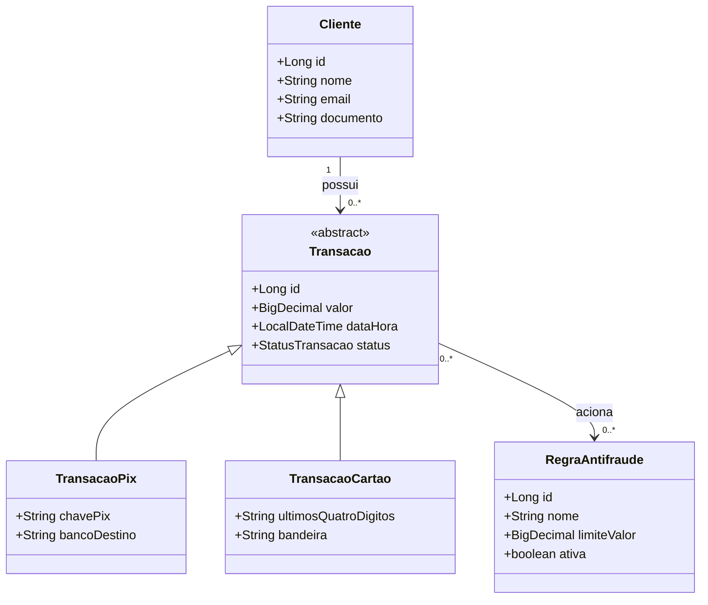

# FraudGuard API

API REST acadêmica para cadastro de **clientes**, **regras antifraude** e **transações PIX/cartão**, desenvolvida com **Java 21, Spring Boot 3.5, Spring Data JPA, PostgreSQL** e documentação **Swagger/OpenAPI**.

> **Escopo:** demonstra os conceitos de POO, herança JPA, relacionamentos 1:N e N:N e CRUD completo. Não implementa um motor real de prevenção a fraudes; as regras são cadastradas e vinculadas às transações manualmente.

## Requisitos da atividade (todos contemplados no código)

| Exigência | Implementação | Arquivos |
| --- | --- | --- |
| Herança | `Transacao` é classe abstrata `@Entity`, com `@Inheritance(JOINED)`; `TransacaoPix` e `TransacaoCartao` são subclasses concretas | `domain/Transacao.java`, `domain/TransacaoPix.java`, `domain/TransacaoCartao.java` |
| Associação 1:N | `Cliente` tem `@OneToMany(mappedBy="cliente")`; `Transacao` tem `@ManyToOne` para `Cliente` | `domain/Cliente.java`, `domain/Transacao.java` |
| Associação N:N | `Transacao` tem `@ManyToMany` com `RegraAntifraude`, usando tabela `transacao_regras` | `domain/Transacao.java`, `domain/RegraAntifraude.java` |
| CRUD completo | POST, GET, PUT e DELETE em todas as **entidades concretas**: Cliente, RegraAntifraude, TransacaoPix e TransacaoCartao | `api/*Controller.java` |
| Banco relacional | PostgreSQL 16; Hibernate/JPA cria as tabelas de demonstração | `compose.yaml`, `application.properties` |

### Diagrama de entidades



**Tabelas físicas:** `clientes`, `transacoes`, `transacoes_pix`, `transacoes_cartao`, `regras_antifraude`, `transacao_regras`. As duas tabelas das subclasses possuem uma chave primária que também referencia a tabela `transacoes`.

## Como executar

**Pré-requisitos:** Java 21, Maven 3.6.3+ e Docker com Docker Compose.

Na pasta raiz do projeto:

```bash
docker compose up -d
mvn spring-boot:run
```

- API: http://localhost:8080
- **Swagger interativo:** http://localhost:8080/swagger-ui.html
- Documento OpenAPI: http://localhost:8080/v3/api-docs
- Banco: `localhost:5432`, nome `fraudguard`, usuário `fraudguard`, senha de demonstração `fraudguard`.

O Spring Boot lê as variáveis de ambiente `DB_URL`, `DB_USER`, `DB_PASSWORD` e `PORT` se forem definidas. **Troque as credenciais em uma implantação real.** O `ddl-auto=update` é intencional para uso didático/local; em produção, utilize migrações (Flyway/Liquibase) e `validate`.

## Endpoints

| Entidade | Inserir | Consultar todos | Consultar por ID | Alterar | Excluir |
| --- | --- | --- | --- | --- | --- |
| Cliente | `POST /api/clientes` | `GET /api/clientes` | `GET /api/clientes/{id}` | `PUT /api/clientes/{id}` | `DELETE /api/clientes/{id}` |
| Regra | `POST /api/regras` | `GET /api/regras` | `GET /api/regras/{id}` | `PUT /api/regras/{id}` | `DELETE /api/regras/{id}` |
| PIX | `POST /api/transacoes/pix` | `GET /api/transacoes/pix` | `GET /api/transacoes/pix/{id}` | `PUT /api/transacoes/pix/{id}` | `DELETE /api/transacoes/pix/{id}` |
| Cartão | `POST /api/transacoes/cartao` | `GET /api/transacoes/cartao` | `GET /api/transacoes/cartao/{id}` | `PUT /api/transacoes/cartao/{id}` | `DELETE /api/transacoes/cartao/{id}` |

`Transacao` é **abstrata**: não há instâncias diretas, logo o cadastro é feito por `pix` ou `cartao`. Há dois endpoints adicionais para demonstrar **polimorfismo**: `GET /api/transacoes` e `GET /api/transacoes/{id}` consultam qualquer subtipo.

### Demonstração de ponta a ponta

**1. Crie um cliente** — `POST /api/clientes`:

```json
{"nome":"Ana Silva","email":"ana@exemplo.com","documento":"12345678901"}
```

**2. Crie uma regra** — `POST /api/regras`:

```json
{"nome":"Alto valor","descricao":"Monitorar compras acima de R$ 1000","limiteValor":1000.00,"ativa":true}
```

**3. Crie um PIX** — `POST /api/transacoes/pix` (substitua os IDs pelos retornados em 1 e 2):

```json
{"valor":2500.50,"status":"PENDENTE","clienteId":1,"regraIds":[1],"chavePix":"ana@pix.com","bancoDestino":"Banco Exemplo"}
```

**4. Crie uma transação de cartão** — `POST /api/transacoes/cartao`:

```json
{"valor":190.90,"status":"APROVADA","clienteId":1,"regraIds":[1],"ultimosQuatroDigitos":"1234","bandeira":"VISA"}
```

**5. Veja herança e associações** — `GET /api/transacoes`:

- As duas transações aparecem na mesma lista, com `tipo` (`PIX`/`CARTAO`) e campos próprios.
- Ambas têm `clienteId=1` (**1:N**).
- Ambas têm `regraIds=[1]` (**N:N**). Também é possível indicar várias regras no mesmo `regraIds`.

**6. Altere** — envie novamente o JSON completo por `PUT` na URL com ID; por exemplo, altere `status` para `BLOQUEADA`.

**7. Exclua** — use `DELETE` nas URLs com ID. Uma regra pode ser removida mesmo estando vinculada; a API remove os vínculos. Um cliente que ainda possui transações retorna **409 Conflict** para evitar exclusão acidental do histórico: exclua as transações primeiro.

### Status e validações

- `201 Created` para inserção, `200 OK` para leitura e alteração, `204 No Content` para exclusão.
- `400 Bad Request` para payloads inválidos, `404 Not Found` para IDs inexistentes, `409 Conflict` para duplicatas ou exclusão de cliente com transações.
- `status` aceita `PENDENTE`, `APROVADA` ou `BLOQUEADA`. `valor` deve ser positivo; o documento do cliente contém 11 ou 14 dígitos (verificação **de formato**, não do dígito verificador).
- `PUT` faz a substituição completa dos campos editáveis e não altera `dataHora` nem o ID.
- O campo `regraIds` é obrigatório e aceita `[]` (nenhuma regra associada).

## Testes automatizados

```bash
mvn test
mvn clean package
```

Os testes de integração usam **H2 em memória**, sem exigir PostgreSQL externo. Exercitam CRUD das quatro entidades concretas, consulta polimórfica, relacionamentos 1:N e N:N, exclusão de vínculos, status HTTP e validação.

## Estrutura de pastas

```text
src/main/java/br/com/fraudguard/
  FraudGuardApplication.java   # classe principal
  domain/                      # entidades JPA, herança e enum
  repository/                  # interfaces Spring Data JPA
  service/                     # regras de CRUD e integridade
  api/                         # controllers REST, DTOs e tratamento de erros
  config/                      # OpenAPI/Swagger
src/main/resources/application.properties
src/test/java/br/com/fraudguard/   # testes de integração
src/test/resources/application-test.properties
compose.yaml                   # PostgreSQL de desenvolvimento
requisicoes.http                # exemplos de requisições para demonstração
.github/workflows/ci.yml       # build e testes automáticos ao publicar
pom.xml                        # dependências Maven
```

## Como explicar ao professor

> "Nossa aplicação é uma API REST que gerencia clientes e transações financeiras. A entidade abstrata `Transacao` usa herança `JOINED`, de modo que transações PIX e cartão compartilham dados básicos, mas têm atributos especializados. Um cliente pode ter muitas transações, o que representa 1:N; uma transação pode estar associada a várias regras antifraude, e uma mesma regra pode ser acionada por várias transações, formando N:N com tabela intermediária. Controllers expõem CRUD para todas as quatro entidades concretas. JPA/Hibernate faz a persistência em PostgreSQL e o Swagger permite demonstrar cada operação sem construir um front-end."

### Limitações intencionais

Este é um **protótipo didático**, não um sistema financeiro real. Não há autenticação/autorização, criptografia de dados pessoais, aprovação automática de regras, trilha de auditoria, migrations nem estratégias de escalabilidade. Não use dados de clientes ou cartões reais.
